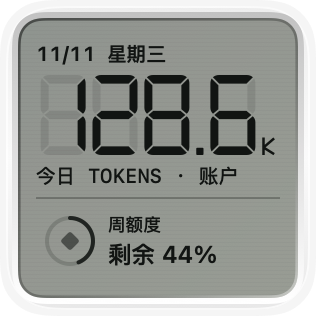
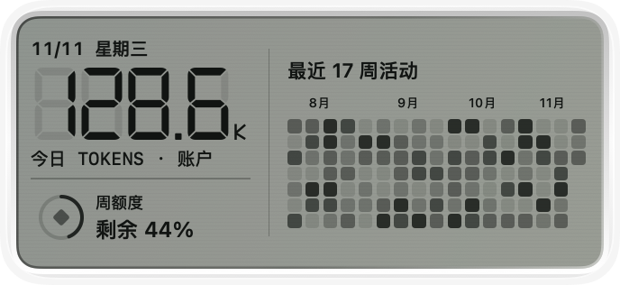
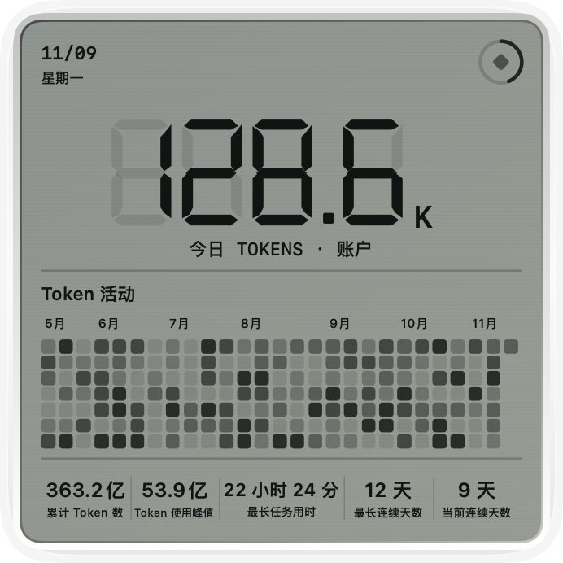

# Token Usage for Codex

原生 macOS 应用和桌面小组件。通过复古液晶面板查看 Codex 今日 Token 用量、近期活动和账户额度。

<p align="center">
  
  
</p>
<p align="center">
  
</p>

*三张效果图均由项目的 SwiftUI 面板使用同一份内置预览数据渲染。*

## 面板内容

- **今日 Token**：按系统时区统计当天用量。「账户」表示来自 Codex 账户，「本机」表示来自这台 Mac 上的 Codex 会话日志。
- **活动热力图**：中号小组件展示截至本周的 17 周活动，大号展示 27 周活动。点击格子会打开 App 并定位到对应日期。在 App 内，悬停格子可查看日期和用量，也可用触控板横向滑动或按住 Shift 滚动鼠标滚轮，查看账户提供的更早记录。
- **账户统计**：累计 Token 数、单日 Token 峰值、最长任务用时、最长连续天数和当前连续天数。
- **额度圆环**：菱形代表套餐，圆环表示每周额度剩余比例。叠放的硬币代表积分，有可用积分时显示完整圆环。在 App 内悬停可查看剩余比例或积分余额。

## 安装与使用

需要 macOS 14 或更新版本。从源码构建需要 Xcode 16 或更新版本。查看账户数据需要在 Codex 中登录支持账户用量的账号，例如 ChatGPT 账号，并使用支持账户用量接口的 Codex CLI。App 也能使用安装在 `/Applications` 下的 ChatGPT 桌面版随附的 CLI。

1. 在仓库根目录构建并打开 App。

   ```sh
   ./Scripts/build-app
   open 'dist/Token Usage.app'
   ```

2. App 启动后自动读取用量，也可以点击「立即刷新」。
3. 在 macOS 桌面右键选择「编辑小组件」，搜索 **Token Usage**。小号展示今日用量和额度，中号加上活动热力图，大号还包含完整的账户统计。

App 和小组件支持简体中文、繁体中文和英文，默认跟随 macOS 首选语言。可在「系统设置 → 通用 → 语言与地区」调整系统语言，也可在同一页的「应用程序」中单独设置 Token Usage 的语言。首选语言列表中没有受支持的语言时，显示英文。

构建脚本会检查应用图标、更新本地签名的 `dist/Token Usage.app`，并注册这份副本的小组件。升级时，先退出正在运行的旧版，再构建并打开 `dist` 中的新版本。

## 数据与刷新

- **账户数据**：App 通过标准输入输出与 `codex app-server` 通信，分别调用 `account/usage/read` 读取用量及统计，调用 `account/rateLimits/read` 读取额度。套餐与积分的切换优先依据服务端的 `ordinaryUsageAllowed`，旧版 CLI 则根据额度窗口和限额状态推断。额度查询失败时显示空环，用量仍单独刷新。超过 45 分钟的额度缓存会在悬停提示中标记。
- **本机数据**：App 增量读取 Codex 数据目录中 `sessions` 和 `archived_sessions` 下的用量事件。账户查询失败或缺少当天记录时，如有本机统计，今日数字会切换到本机用量。账户恢复并返回当天记录后，今日数字会切回账户用量。热力图的历史数据和账户统计使用最近一次成功查询的账户数据。
- **刷新与存储**：App 运行期间，即使关闭窗口，也会分别每分钟刷新本机统计、账户用量和额度。数据有变化时，App 会合并刷新请求；点击「立即刷新」也会在读完数据后请求小组件更新。桌面显示的刷新时机由 WidgetKit 决定。退出 App 后，小组件继续使用最近保存的快照。快照与本机日志读取进度保存在 `~/Library/Application Support/CodexTokenWidget/`。

## 常见问题

- **找不到 Codex CLI**：App 按顺序查找 `CODEX_TOKEN_WIDGET_CLI`、`PATH`、常见安装位置和 ChatGPT 桌面版随附的 CLI。自定义安装时，可以在启动 App 的进程环境中将 `CODEX_TOKEN_WIDGET_CLI` 设为可执行文件的绝对路径。
- **本机统计未读取预期目录**：App 默认读取 `~/.codex`。如果 Codex 使用自定义目录，请在启动 App 的进程环境中将 `CODEX_HOME` 设为相同的绝对路径。
- **小组件图库仍显示旧样式**：关闭图库，在终端执行 `killall NotificationCenter`，再打开图库。如果通过 Xcode 运行过其他构建副本，可用 `pluginkit -m -A -D -v -i dev.codextoken.app.widget` 检查注册路径。图库使用内置示例数据，桌面小组件使用 App 保存的快照。
- **App 有新数据，桌面小组件没有更新**：如果移动过仓库，或通过 Xcode 运行过 App，退出旧副本，重新执行 `./Scripts/build-app` 并打开 `dist/Token Usage.app`。如果桌面仍保留旧的小组件实例，移除后再从图库添加。
- **指标显示「—」**：该指标暂时缺少数据。可以在 App 中点击「立即刷新」，并查看窗口中的错误提示。

## 开发与测试

用 Xcode 打开 `CodexToken.xcodeproj`，选择 `CodexToken` 方案运行。也可以在仓库根目录执行测试脚本。

```sh
./Scripts/test
```

[Codex App Server 接口文档](https://developers.openai.com/codex/app-server)
